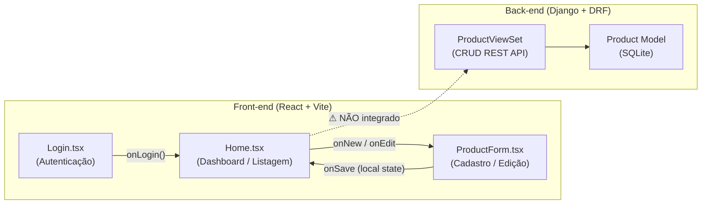
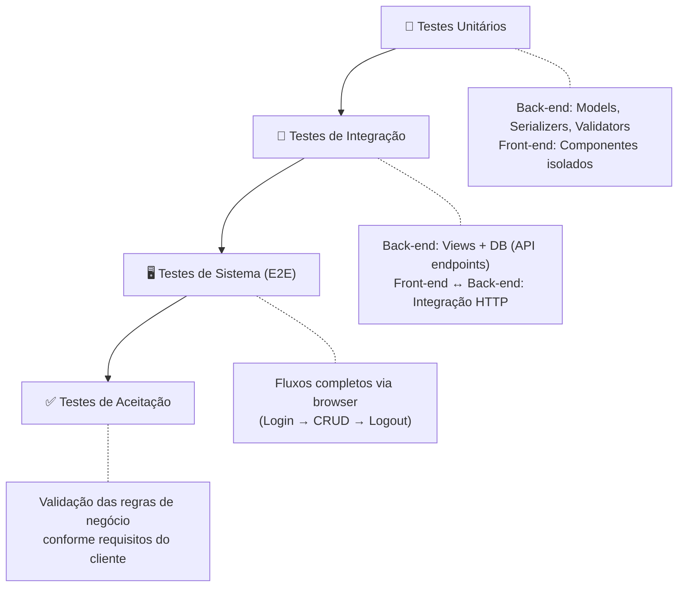
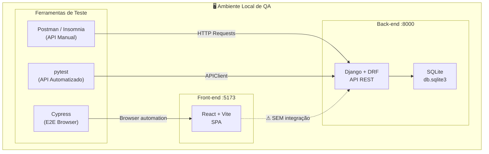

# 📋 Projeto de QA — Cafeteria "Grão & Prosa" (CodeWave Solutions)

## Item 1: Análise de Requisitos e Riscos

---

### 1.1 Visão Geral da Arquitetura e Tecnologias



| Camada | Tecnologia | Versão | Detalhes |
|--------|-----------|--------|---------|
| **Back-end** | Python / Django | 6.1.3 | Framework web |
| **Back-end** | Django REST Framework | 3.18.3 | API RESTful |
| **Back-end** | SQLite | — | Banco de dados padrão |
| **Back-end** | django-cors-headers | 4.9.0 | Habilita CORS (`CORS_ALLOW_ALL_ORIGINS = True`) |
| **Front-end** | React | 19.3.1 | Biblioteca UI |
| **Front-end** | TypeScript | 7.0.2 | Tipagem estática |
| **Front-end** | Vite | 8.3.5 | Build tool / dev server |
| **Front-end** | OxLint | 1.89.0 | Linter |

---

### 1.2 Mapeamento Completo das Funcionalidades

#### 1.2.1 Back-end — API REST de Produtos

A API expõe um **CRUD completo** de Produtos via `ModelViewSet` do DRF, registrado no router com prefixo `api/products/`.

| Endpoint | Método HTTP | Ação | Descrição |
|----------|------------|------|-----------|
| `GET /api/products/` | GET | **List** | Lista todos os produtos cadastrados |
| `POST /api/products/` | POST | **Create** | Cadastra um novo produto |
| `GET /api/products/{id}/` | GET | **Retrieve** | Retorna detalhes de um produto específico |
| `PUT /api/products/{id}/` | PUT | **Update** | Atualiza todos os campos de um produto |
| `PATCH /api/products/{id}/` | PATCH | **Partial Update** | Atualiza parcialmente um produto |
| `DELETE /api/products/{id}/` | DELETE | **Destroy** | Remove um produto |

**Modelo `Product`** (campos e restrições):

| Campo | Tipo | Restrições / Validações |
|-------|------|------------------------|
| `id` | BigAutoField | PK, auto-incremento |
| `name` | CharField | `max_length=100`, obrigatório |
| `category` | CharField | `max_length=50`, obrigatório |
| `price` | DecimalField | `max_digits=10`, `decimal_places=2`, `MinValueValidator(0.01)` |
| `stock` | IntegerField | `MinValueValidator(0)` |

**Script de seed** (`popular_banco.py`): Popula o banco com 5 produtos pré-definidos (Café Expresso, Cappuccino, Pão de queijo, Brownie, Suco de laranja) via POST na API.

#### 1.2.2 Front-end — Telas e Funcionalidades

| Tela / Componente | Funcionalidades | Observações |
|-------------------|----------------|-------------|
| **Login** (`Login.tsx`) | Formulário com campos e-mail e senha; botão "Entrar no painel" | ⚠ **Sem validação real de credenciais** — qualquer input (inclusive vazio) faz login com sucesso. Apenas chama `onLogin()` |
| **Home / Dashboard** (`Home.tsx`) | Cards de resumo (total de produtos, estoque total, valor em estoque); tabela de listagem de produtos; busca por nome; filtro por categoria (Todas/Cafés/Bebidas/Salgados/Doces); botões de Editar e Remover por produto; botão "Novo produto" | Busca usa `includes()` case-sensitive. Cálculos: `totalValue = Σ(price × stock)`, `totalStock = Σ(stock)` |
| **ProductForm** (`ProductForm.tsx`) | Formulário com 4 campos: Nome, Categoria (select), Preço (number, step 0.01), Estoque (number); botões Cancelar e "Salvar produto" | ⚠ **Sem validações no front-end** — permite salvar com campos vazios, preço 0 ou negativo, estoque negativo. Categorias fixas: Cafés, Bebidas, Salgados, Doces |

> [!IMPORTANT]
> **Achado crítico:** O front-end **NÃO** faz chamadas à API do back-end. Todos os dados são gerenciados em **estado local** (React `useState`) com dados iniciais hardcoded em `App.tsx`. O back-end e o front-end são **sistemas desacoplados e não integrados**.

#### 1.2.3 Funcionalidades Descritas no Contexto vs. Implementadas

| Funcionalidade (Contexto) | Back-end | Front-end | Status |
|---------------------------|----------|-----------|--------|
| Gestão de **Produtos** (CRUD) | ✅ API completa | ✅ CRUD local | ⚠ Sem integração |
| **Reservas** de mesas | ❌ Não implementado | ❌ Não implementado | 🔴 Ausente |
| **Pedidos** | ❌ Não implementado | ❌ Não implementado | 🔴 Ausente |
| **Atendimento** | ❌ Não implementado | ❌ Não implementado | 🔴 Ausente |
| **Autenticação** real | ❌ Sem auth na API | ⚠ Formulário cosmético | 🔴 Não funcional |
| **Cadastro de usuários** | ❌ Não implementado | ❌ Não implementado | 🔴 Ausente |

---

### 1.3 Regras de Negócio Identificadas

| ID | Regra de Negócio | Origem | Validação |
|----|-----------------|--------|-----------|
| **RN-01** | O preço do produto deve ser ≥ R$ 0,01 | `models.py` → `MinValueValidator(0.01)` | Apenas no back-end |
| **RN-02** | O estoque do produto deve ser ≥ 0 (não permite negativo) | `models.py` → `MinValueValidator(0)` | Apenas no back-end |
| **RN-03** | O nome do produto aceita no máximo 100 caracteres | `models.py` → `max_length=100` | Apenas no back-end |
| **RN-04** | A categoria do produto aceita no máximo 50 caracteres | `models.py` → `max_length=50` | Apenas no back-end |
| **RN-05** | O preço tem no máximo 10 dígitos com 2 casas decimais | `models.py` → `max_digits=10, decimal_places=2` | Apenas no back-end |
| **RN-06** | As categorias válidas no front-end são: Cafés, Bebidas, Salgados, Doces | `ProductForm.tsx` / `Home.tsx` | Apenas no front-end |
| **RN-07** | O login deve autenticar o usuário antes de acessar o painel | Regra implícita do contexto | ⚠ Não implementada |
| **RN-08** | Cada produto tem ID único auto-incrementado | `models.py` (BigAutoField) / `App.tsx` (nextId) | Ambos (separados) |
| **RN-09** | A busca de produtos filtra por nome | `Home.tsx` → `product.name.includes(search)` | Case-sensitive (possível bug) |
| **RN-10** | Estoque baixo (< 10) é destacado visualmente em cor diferente | `Home.tsx` → cor `#bd704b` | Front-end apenas |

---

### 1.4 Análise de Riscos

#### 1.4.1 Riscos Técnicos

| ID | Risco | Probabilidade | Impacto | Severidade | Mitigação Sugerida |
|----|-------|---------------|---------|------------|---------------------|
| **RT-01** | Front-end não integrado ao back-end (dados voláteis em memória) | Confirmado | 🔴 Crítico | **Bloqueante** | Implementar chamadas HTTP (fetch/axios) no front para consumir a API |
| **RT-02** | Ausência de autenticação/autorização na API (qualquer pessoa pode fazer CRUD) | Confirmado | 🔴 Crítico | **Crítico** | Implementar DRF Token Auth ou JWT |
| **RT-03** | `SECRET_KEY` hardcoded e `DEBUG=True` no settings de produção | Confirmado | 🔴 Alto | **Crítico** | Usar variáveis de ambiente (`.env`) e `DEBUG=False` em produção |
| **RT-04** | `ALLOWED_HOSTS = ['*']` e `CORS_ALLOW_ALL_ORIGINS = True` | Confirmado | 🟠 Alto | **Alto** | Restringir a domínios específicos |
| **RT-05** | Falta de validação no front-end (campos vazios, preço ≤ 0, estoque negativo) | Confirmado | 🟠 Alto | **Alto** | Adicionar validações no formulário antes do submit |
| **RT-06** | Busca case-sensitive (`includes` sem `.toLowerCase()`) | Confirmado | 🟡 Médio | **Médio** | Usar `name.toLowerCase().includes(search.toLowerCase())` |
| **RT-07** | SQLite como banco de dados (não escalável para produção) | Confirmado | 🟡 Médio | **Médio** | Migrar para PostgreSQL/MySQL em produção |
| **RT-08** | Arquivo `tests.py` vazio — zero cobertura de testes automatizados | Confirmado | 🟡 Médio | **Médio** | Implementar suíte de testes (unitários + integração) |
| **RT-09** | Dados iniciais hardcoded em `App.tsx` divergem dos dados do `popular_banco.py` | Confirmado | 🟡 Médio | **Baixo** | Unificar fonte de dados; front deve consumir API |

#### 1.4.2 Riscos de Negócio

| ID | Risco | Probabilidade | Impacto | Severidade |
|----|-------|---------------|---------|------------|
| **RN-R01** | Funcionalidades de **reservas**, **pedidos** e **atendimento** (descritas no contexto) estão completamente ausentes | Confirmado | 🔴 Crítico | **Bloqueante** |
| **RN-R02** | Login cosmético permite acesso irrestrito ao painel sem validação de credenciais | Confirmado | 🔴 Crítico | **Crítico** |
| **RN-R03** | Produto pode ser cadastrado com nome vazio e preço/estoque inválidos (via front-end) | Confirmado | 🟠 Alto | **Alto** |
| **RN-R04** | Dados de produtos são perdidos ao recarregar a página (estado React local) | Confirmado | 🔴 Crítico | **Crítico** |
| **RN-R05** | Sem controle de concorrência — dois acessos simultâneos podem sobrescrever dados | Provável | 🟡 Médio | **Médio** |

---

### 1.5 Níveis e Técnicas de Teste Recomendados

#### 1.5.1 Níveis de Teste



| Nível | Escopo | Ferramentas Sugeridas | Prioridade |
|-------|--------|----------------------|------------|
| **Unitário** | Model `Product` (validators), Serializer, funções JS/TS isoladas | `pytest` + `pytest-django` (back), `Vitest` (front) | 🟢 Alta |
| **Integração (API)** | Endpoints REST (CRUD completo), status codes, payloads | `pytest` + DRF `APIClient`, **Postman/Insomnia** (manual) | 🔴 Crítica |
| **Sistema / E2E** | Fluxos de usuário completos no browser | **Cypress** ou **Playwright** | 🟢 Alta |
| **Aceitação** | Requisitos do negócio (reservas, pedidos, etc.) | Manual + checklists | 🟡 Média (limitada por ausência de funcionalidades) |

#### 1.5.2 Técnicas de Teste

| Técnica | Aplicação no Projeto | Exemplos |
|---------|---------------------|----------|
| **Caixa-Preta** (Funcional) | Testar endpoints da API e UI sem ver código | Enviar POST com dados válidos/inválidos e verificar resposta |
| **Caixa-Branca** (Estrutural) | Cobertura de código das views, models, serializers | Verificar que todos os branches do `handleSubmit` são exercitados |
| **Particionamento de Equivalência** | Dividir inputs em classes válidas e inválidas | Preço: classe válida (0.01–99999999.99), inválida (≤0, letras, vazio) |
| **Análise de Valor Limite** | Testar nos limites exatos dos campos | `name`: 100 chars (ok) vs 101 chars (falha); `price`: 0.00 vs 0.01; `stock`: -1 vs 0 |
| **Tabela de Decisão** | Combinações de entradas do formulário de produto | Nome vazio + preço válido → erro; Nome ok + preço 0 → erro; Tudo ok → sucesso |
| **Teste de Estado** | Transições de tela no front-end | Login → Home → New → Home → Edit → Home |
| **Teste Exploratório** | Descoberta de bugs não previstos | Navegar livremente, tentar ações inesperadas |

#### 1.5.3 Matriz de Cobertura (Técnica × Funcionalidade)

| Funcionalidade | Caixa-Preta | Valor Limite | Part. Equivalência | Tabela Decisão | Exploratório |
|---------------|-------------|-------------|--------------------|--------------------|-------------|
| Login | ✅ | — | ✅ | ✅ | ✅ |
| Listar Produtos | ✅ | — | — | — | ✅ |
| Busca/Filtro | ✅ | ✅ | ✅ | — | ✅ |
| Criar Produto | ✅ | ✅ | ✅ | ✅ | ✅ |
| Editar Produto | ✅ | ✅ | ✅ | ✅ | ✅ |
| Excluir Produto | ✅ | — | — | — | ✅ |
| API CRUD (Back) | ✅ | ✅ | ✅ | ✅ | ✅ |
| Cards de Resumo | ✅ | — | — | — | ✅ |

---

---

## Item 3: Guia de Configuração do Ambiente de Validação

---

### 3.1 Pré-requisitos

| Ferramenta | Versão Mínima | Link de Download |
|-----------|---------------|------------------|
| **Git** | 2.x | https://git-scm.com/downloads |
| **Python** | 3.12+ | https://www.python.org/downloads/ |
| **pip** | (incluído no Python) | — |
| **Node.js** | 20.x LTS ou 22.x | https://nodejs.org/ |
| **npm** | (incluído no Node.js) | — |

---

### 3.2 Configuração do Back-end (Django + DRF)

#### Passo 1 — Clonar o repositório

```bash
git clone https://github.com/Viniciusalmei/Cafeteria-Backend-Teste.git
cd Cafeteria-Backend-Teste
```

#### Passo 2 — Criar e ativar o ambiente virtual

```bash
# Windows (PowerShell)
python -m venv venv
.\venv\Scripts\Activate.ps1

# Linux / macOS
python3 -m venv venv
source venv/bin/activate
```

#### Passo 3 — Instalar dependências

```bash
pip install -r requirements.txt
```

#### Passo 4 — Aplicar migrações do banco de dados (SQLite)

```bash
python manage.py migrate
```

#### Passo 5 — Criar superusuário para o Django Admin (opcional)

```bash
python manage.py createsuperuser
```
> Siga as instruções para definir username, email e senha.

#### Passo 6 — Popular o banco de dados com dados iniciais

```bash
# Primeiro, inicie o servidor (Passo 7) e depois execute:
python popular_banco.py
```

#### Passo 7 — Iniciar o servidor de desenvolvimento

```bash
python manage.py runserver
```
> O back-end ficará disponível em **http://127.0.0.1:8000/**

#### Verificação rápida

```bash
# Em outro terminal, teste a API:
curl http://127.0.0.1:8000/api/products/

# Resposta esperada (após popular o banco): JSON com 5 produtos
```

| URL | Descrição |
|-----|-----------|
| `http://127.0.0.1:8000/api/products/` | API REST (Browsable API do DRF) |
| `http://127.0.0.1:8000/admin/` | Django Admin Panel |

---

### 3.3 Configuração do Front-end (React + Vite)

#### Passo 1 — Clonar o repositório

```bash
git clone https://github.com/Viniciusalmei/Cafeteria-Frontend-Teste.git
cd Cafeteria-Frontend-Teste/CafeteriaFrontend
```

> [!NOTE]
> O projeto React está dentro da subpasta `CafeteriaFrontend/`.

#### Passo 2 — Instalar dependências

```bash
npm install
```

#### Passo 3 — Iniciar o servidor de desenvolvimento

```bash
npm run dev
```
> O front-end ficará disponível em **http://localhost:5173/** (padrão do Vite)

#### Verificação rápida

1. Abra `http://localhost:5173/` no navegador
2. A tela de **Login** deve aparecer (tema marrom/café com ☕)
3. Clique em "Entrar no painel" (qualquer input funciona)
4. O **Dashboard** deve exibir 5 produtos pré-carregados

---

### 3.4 Variáveis de Ambiente e Configurações Relevantes

#### Back-end (`cafeteria/settings.py`)

| Configuração | Valor Atual | Risco | Ação para Produção |
|-------------|-------------|-------|---------------------|
| `SECRET_KEY` | Hardcoded (insecure) | 🔴 Crítico | Mover para variável de ambiente |
| `DEBUG` | `True` | 🔴 Crítico | Definir como `False` |
| `ALLOWED_HOSTS` | `['*']` | 🟠 Alto | Restringir aos domínios reais |
| `CORS_ALLOW_ALL_ORIGINS` | `True` | 🟠 Alto | Usar `CORS_ALLOWED_ORIGINS` com lista explícita |
| `DATABASES` | SQLite (arquivo local) | 🟡 Médio | Migrar para PostgreSQL |

#### Front-end

| Configuração | Valor Atual | Observação |
|-------------|-------------|------------|
| URL da API | Nenhuma configurada | ⚠ O front-end não faz chamadas ao back-end |
| Porta dev server | 5173 (padrão Vite) | Configurável em `vite.config.ts` |

---

### 3.5 Ferramentas Recomendadas para Testes

#### 3.5.1 Testes Manuais

| Ferramenta | Finalidade | Download |
|-----------|-----------|----------|
| **Postman** | Testes manuais de API REST (coleções, variáveis, assertions) | https://www.postman.com/downloads/ |
| **Insomnia** | Alternativa leve ao Postman para testes de API | https://insomnia.rest/download |
| **DevTools do Browser** | Inspecionar rede, console, elementos, estado React | Integrado (F12) |

#### 3.5.2 Testes Automatizados — Back-end

| Ferramenta | Finalidade | Instalação |
|-----------|-----------|------------|
| **pytest** + **pytest-django** | Testes unitários e de integração Django | `pip install pytest pytest-django` |
| **DRF APIClient** | Testes de endpoints REST (já incluso no DRF) | Incluso no `djangorestframework` |
| **coverage** | Relatório de cobertura de código | `pip install coverage` |
| **factory-boy** | Fábricas de dados para testes | `pip install factory-boy` |

#### 3.5.3 Testes Automatizados — Front-end / E2E

| Ferramenta | Finalidade | Instalação |
|-----------|-----------|------------|
| **Cypress** | Testes E2E no browser (já tem `data-cy` nos elementos!) | `npm install --save-dev cypress` |
| **Playwright** | Alternativa ao Cypress, multi-browser | `npm install --save-dev @playwright/test` |
| **Vitest** | Testes unitários para componentes React | `npm install --save-dev vitest @testing-library/react` |

> [!TIP]
> O front-end **já possui seletores `data-cy`** nos elementos-chave (`data-cy="email"`, `data-cy="password"`, `data-cy="login-button"`, `data-cy="new-product"`, `data-cy="search"`, `data-cy="product-name"`, `data-cy="product-category"`, `data-cy="product-price"`, `data-cy="product-stock"`, `data-cy="save-product"`, `data-cy="edit-{id}"`, `data-cy="delete-{id}"`), o que indica que o **Cypress** foi a ferramenta prevista para automação E2E.

---

### 3.6 Arquitetura do Ambiente de Teste



---

### 3.7 Checklist de Verificação do Ambiente

- [ ] Python instalado e acessível no PATH
- [ ] Node.js e npm instalados e acessíveis no PATH
- [ ] Back-end clonado e dependências instaladas (`pip install -r requirements.txt`)
- [ ] Migrações aplicadas (`python manage.py migrate`)
- [ ] Servidor back-end rodando em `http://127.0.0.1:8000/`
- [ ] `GET /api/products/` retorna HTTP 200
- [ ] Dados iniciais populados (`python popular_banco.py`)
- [ ] Front-end clonado e dependências instaladas (`npm install`)
- [ ] Servidor front-end rodando em `http://localhost:5173/`
- [ ] Tela de login renderizando corretamente
- [ ] Login funcional (redireciona ao Dashboard)
- [ ] Dashboard exibindo 5 produtos com cards de resumo
- [ ] Postman/Insomnia instalado para testes de API
- [ ] Cypress ou Playwright configurado para testes E2E

---

> [!WARNING]
> **Observação Final para a Equipe de QA:** A falta de integração entre front-end e back-end significa que os testes devem ser planejados em **duas frentes independentes**:
> 1. **Testes de API** (Back-end): Testar o CRUD REST diretamente via Postman/pytest, validando regras de negócio, status codes e payloads.
> 2. **Testes de UI** (Front-end): Testar fluxos de tela no browser, sabendo que os dados são locais e voláteis.
> 
> Essa separação será refletida nos cenários de teste do **Item 2**.
