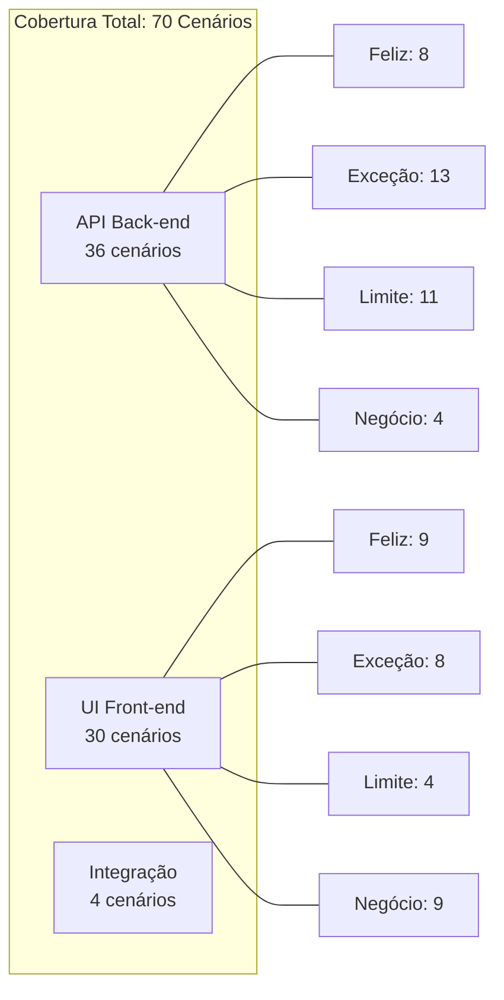

#  Item 2 — Plano e Cenários de Teste

**Projeto:** Cafeteria "Grao & Prosa" - CodeWave Solutions  
**Responsavel de QA:** Kaique Daniel  
**Instituicao:** SENAI "Roberto Mange" - Unidade Curricular: Teste de Software (TSOF)  
**Data:** 24/11/2026  

---

## Projeto: Cafeteria "Grão & Prosa" — CodeWave Solutions

---

## 2.1 Estratégia Geral de Testes

Conforme identificado na Análise de Requisitos (Item 1), o front-end e o back-end **não estão integrados**. Portanto, os cenários são divididos em **duas frentes**:

| Frente | Prefixo | Escopo | Ferramenta |
|--------|---------|--------|------------|
| **API (Back-end)** | `API-` | Endpoints REST `/api/products/` | Postman / pytest |
| **UI (Front-end)** | `UI-` | Telas Login, Home, ProductForm | Cypress / Manual |

---

## 2.2 Cenários de API — Back-end (Django REST Framework)

### 2.2.1 Caminho Feliz (Happy Path)

| ID | Título | Pré-condições | Passos | Dados de Entrada | Resultado Esperado |
|----|--------|---------------|--------|------------------|-------------------|
| API-001 | Listar todos os produtos | Banco populado com ≥1 produto | 1. Enviar `GET /api/products/` | — | Status **200 OK**; Body = array JSON com todos os produtos; cada objeto contém `id`, `name`, `category`, `price`, `stock` |
| API-002 | Criar produto com dados válidos | Servidor rodando | 1. Enviar `POST /api/products/` com body JSON válido | `{"name":"Chá Verde","category":"Bebidas","price":"5.00","stock":20}` | Status **201 Created**; Body = objeto criado com `id` auto-gerado; campos iguais aos enviados |
| API-003 | Consultar produto por ID | Produto com `id=1` existe | 1. Enviar `GET /api/products/1/` | — | Status **200 OK**; Body = objeto do produto com `id=1` |
| API-004 | Atualizar produto completo (PUT) | Produto com `id=1` existe | 1. Enviar `PUT /api/products/1/` com todos os campos | `{"name":"Café Premium","category":"Cafés","price":"12.00","stock":15}` | Status **200 OK**; Body = produto atualizado com novos valores |
| API-005 | Atualizar produto parcial (PATCH) | Produto com `id=1` existe | 1. Enviar `PATCH /api/products/1/` com campo parcial | `{"price":"7.50"}` | Status **200 OK**; Apenas `price` alterado; demais campos mantidos |
| API-006 | Excluir produto | Produto com `id=1` existe | 1. Enviar `DELETE /api/products/1/` 2. Enviar `GET /api/products/1/` | — | Passo 1: Status **204 No Content**; Passo 2: Status **404 Not Found** |
| API-007 | Listar produtos com banco vazio | Banco sem registros | 1. Enviar `GET /api/products/` | — | Status **200 OK**; Body = `[]` (array vazio) |
| API-008 | Criar produto com preço mínimo válido | Servidor rodando | 1. Enviar `POST /api/products/` | `{"name":"Item","category":"Doces","price":"0.01","stock":0}` | Status **201 Created**; Produto criado com `price=0.01` e `stock=0` |

### 2.2.2 Cenários de Exceção

| ID | Título | Pré-condições | Passos | Dados de Entrada | Resultado Esperado |
|----|--------|---------------|--------|------------------|-------------------|
| API-009 | Criar produto sem nome | Servidor rodando | 1. Enviar `POST /api/products/` sem campo `name` | `{"category":"Cafés","price":"5.00","stock":10}` | Status **400 Bad Request**; Mensagem de erro indicando que `name` é obrigatório |
| API-010 | Criar produto sem categoria | Servidor rodando | 1. Enviar `POST /api/products/` sem campo `category` | `{"name":"Teste","price":"5.00","stock":10}` | Status **400 Bad Request**; Erro indicando `category` obrigatório |
| API-011 | Criar produto sem preço | Servidor rodando | 1. Enviar `POST /api/products/` sem campo `price` | `{"name":"Teste","category":"Cafés","stock":10}` | Status **400 Bad Request**; Erro indicando `price` obrigatório |
| API-012 | Criar produto sem estoque | Servidor rodando | 1. Enviar `POST /api/products/` sem campo `stock` | `{"name":"Teste","category":"Cafés","price":"5.00"}` | Status **400 Bad Request**; Erro indicando `stock` obrigatório |
| API-013 | Criar produto com preço zero | Servidor rodando | 1. Enviar `POST /api/products/` com `price=0` | `{"name":"Grátis","category":"Cafés","price":"0.00","stock":5}` | Status **400 Bad Request**; Erro: preço deve ser ≥ 0.01 (MinValueValidator) |
| API-014 | Criar produto com preço negativo | Servidor rodando | 1. Enviar `POST /api/products/` com preço negativo | `{"name":"Negativo","category":"Cafés","price":"-5.00","stock":5}` | Status **400 Bad Request**; Erro de validação no campo `price` |
| API-015 | Criar produto com estoque negativo | Servidor rodando | 1. Enviar `POST /api/products/` com estoque negativo | `{"name":"Negativo","category":"Cafés","price":"5.00","stock":-1}` | Status **400 Bad Request**; Erro: estoque deve ser ≥ 0 (MinValueValidator) |
| API-016 | Criar produto com preço não-numérico | Servidor rodando | 1. Enviar `POST /api/products/` com preço texto | `{"name":"Teste","category":"Cafés","price":"abc","stock":5}` | Status **400 Bad Request**; Erro de tipo no campo `price` |
| API-017 | Consultar produto inexistente | Banco sem `id=999` | 1. Enviar `GET /api/products/999/` | — | Status **404 Not Found** |
| API-018 | Atualizar produto inexistente | Banco sem `id=999` | 1. Enviar `PUT /api/products/999/` | `{"name":"X","category":"Y","price":"1.00","stock":1}` | Status **404 Not Found** |
| API-019 | Excluir produto inexistente | Banco sem `id=999` | 1. Enviar `DELETE /api/products/999/` | — | Status **404 Not Found** |
| API-020 | Enviar body vazio no POST | Servidor rodando | 1. Enviar `POST /api/products/` com `{}` | `{}` | Status **400 Bad Request**; Erros de validação para todos os campos obrigatórios |
| API-021 | Enviar método não permitido | Servidor rodando | 1. Enviar `POST /api/products/1/` (POST em rota de detalhe) | — | Status **405 Method Not Allowed** |

### 2.2.3 Análise de Valor Limite

| ID | Título | Pré-condições | Passos | Dados de Entrada | Resultado Esperado |
|----|--------|---------------|--------|------------------|-------------------|
| API-022 | Nome com exatamente 100 caracteres (limite) | Servidor rodando | 1. Enviar `POST` com nome de 100 chars | `{"name":"A"×100,"category":"Cafés","price":"5.00","stock":10}` | Status **201 Created**; Produto criado com nome de 100 caracteres |
| API-023 | Nome com 101 caracteres (acima do limite) | Servidor rodando | 1. Enviar `POST` com nome de 101 chars | `{"name":"A"×101,"category":"Cafés","price":"5.00","stock":10}` | Status **400 Bad Request**; Erro: `max_length` excedido |
| API-024 | Nome com 1 caractere (mínimo) | Servidor rodando | 1. Enviar `POST` com nome de 1 char | `{"name":"A","category":"C","price":"0.01","stock":0}` | Status **201 Created** |
| API-025 | Nome vazio (string vazia) | Servidor rodando | 1. Enviar `POST` com `name=""` | `{"name":"","category":"Cafés","price":"5.00","stock":10}` | Status **400 Bad Request**; Nome não pode ser vazio |
| API-026 | Categoria com exatamente 50 caracteres | Servidor rodando | 1. Enviar `POST` com categoria de 50 chars | `{"name":"Teste","category":"B"×50,"price":"5.00","stock":10}` | Status **201 Created** |
| API-027 | Categoria com 51 caracteres | Servidor rodando | 1. Enviar `POST` com categoria de 51 chars | `{"name":"Teste","category":"B"×51,"price":"5.00","stock":10}` | Status **400 Bad Request** |
| API-028 | Preço no limite superior (99999999.99) | Servidor rodando | 1. Enviar `POST` com preço máximo | `{"name":"Caro","category":"Cafés","price":"99999999.99","stock":1}` | Status **201 Created** |
| API-029 | Preço excedendo `max_digits` | Servidor rodando | 1. Enviar `POST` com preço > 10 dígitos | `{"name":"Caro","category":"Cafés","price":"1000000000.00","stock":1}` | Status **400 Bad Request** |
| API-030 | Preço com 3 casas decimais | Servidor rodando | 1. Enviar `POST` com `price=5.555` | `{"name":"Teste","category":"Cafés","price":"5.555","stock":5}` | Status **400 Bad Request** ou truncamento para `5.56` (verificar comportamento) |
| API-031 | Estoque = 0 (limite inferior válido) | Servidor rodando | 1. Enviar `POST` com `stock=0` | `{"name":"Esgotado","category":"Cafés","price":"5.00","stock":0}` | Status **201 Created**; `stock=0` |
| API-032 | Estoque = -1 (abaixo do limite) | Servidor rodando | 1. Enviar `POST` com `stock=-1` | `{"name":"Negativo","category":"Cafés","price":"5.00","stock":-1}` | Status **400 Bad Request** |

### 2.2.4 Falhas de Negócio

| ID | Título | Pré-condições | Passos | Dados de Entrada | Resultado Esperado |
|----|--------|---------------|--------|------------------|-------------------|
| API-033 | Criar produto duplicado (mesmo nome) | Produto "Café Expresso" já existe | 1. Enviar `POST` com nome idêntico | `{"name":"Café Expresso","category":"Bebidas","price":"6.00","stock":20}` | [ALERTA] **Comportamento a verificar**: API provavelmente aceita duplicata (sem constraint `unique`). Documentar como **defeito potencial** se a regra de negócio exigir nomes únicos |
| API-034 | PUT sem enviar todos os campos obrigatórios | Produto `id=1` existe | 1. Enviar `PUT /api/products/1/` com campos faltando | `{"name":"Novo Nome"}` | Status **400 Bad Request**; PUT requer todos os campos (diferente de PATCH) |
| API-035 | Criar produto com caracteres especiais no nome | Servidor rodando | 1. Enviar `POST` com caracteres especiais | `{"name":"","category":"Cafés","price":"5.00","stock":10}` | Status **201 Created** (aceita), mas dado deve ser sanitizado na exibição |
| API-036 | Enviar campos extras não existentes no modelo | Servidor rodando | 1. Enviar `POST` com campo inventado | `{"name":"T","category":"C","price":"1.00","stock":1,"descricao":"teste"}` | Status **201 Created**; Campo extra ignorado pelo serializer (`fields='__all__'` considera apenas campos do model) |

---

## 2.3 Cenários de UI — Front-end (React)

### 2.3.1 Caminho Feliz (Happy Path)

| ID | Título | Pré-condições | Passos | Dados de Entrada | Resultado Esperado |
|----|--------|---------------|--------|------------------|-------------------|
| UI-001 | Login com sucesso | Página de login aberta | 1. Preencher campo e-mail 2. Preencher campo senha 3. Clicar em "Entrar no painel" | E-mail: `admin@cafe.com` Senha: `123456` | Redireciona para o Dashboard; sidebar com "Grão & Prosa" visível; tabela de produtos exibida |
| UI-002 | Visualizar Dashboard com dados | Usuário logado | 1. Observar cards de resumo 2. Observar tabela de produtos | — | Card "Produtos cadastrados" = `5`; Card "Unidades em estoque" = `102`; Card "Valor em estoque" = `R$ 625,50`; Tabela com 5 linhas |
| UI-003 | Criar novo produto | Usuário logado no Dashboard | 1. Clicar "+ Novo produto" 2. Preencher Nome 3. Selecionar Categoria 4. Preencher Preço 5. Preencher Estoque 6. Clicar "Salvar produto ->" | Nome: `Bolo de Cenoura` Categoria: `Doces` Preço: `12.50` Estoque: `8` | Redireciona ao Dashboard; novo produto aparece na tabela; cards atualizados (6 produtos) |
| UI-004 | Editar produto existente | Usuário logado; ≥1 produto listado | 1. Clicar no botão [Editar] (Editar) do primeiro produto 2. Alterar o nome 3. Alterar o preço 4. Clicar "Salvar produto ->" | Nome: `Café Especial` Preço: `8.00` | Redireciona ao Dashboard; produto exibe novo nome e preço; cards atualizados |
| UI-005 | Excluir produto | Usuário logado; ≥1 produto listado | 1. Clicar no botão [Remover] (Remover) do primeiro produto | — | Produto removido da tabela; cards atualizados (4 produtos); contagem "4 itens" |
| UI-006 | Buscar produto por nome | Usuário logado; produtos listados | 1. Digitar texto no campo de busca | Busca: `Cappuccino` | Tabela filtra exibindo apenas "Cappuccino"; contagem atualizada para "1 itens" |
| UI-007 | Filtrar por categoria | Usuário logado; produtos listados | 1. Selecionar "Cafés" no dropdown de categoria | Categoria: `Cafés` | Tabela filtra exibindo apenas produtos da categoria "Cafés" (Café expresso, Cappuccino) |
| UI-008 | Logout do sistema | Usuário logado | 1. Clicar no botão [Sair] (Sair) na sidebar | — | Retorna à tela de Login |
| UI-009 | Navegar Novo produto -> Cancelar | Usuário logado | 1. Clicar "+ Novo produto" 2. Preencher parcialmente 3. Clicar "Cancelar" | — | Retorna ao Dashboard; nenhum produto criado; dados anteriores mantidos |

### 2.3.2 Cenários de Exceção

| ID | Título | Pré-condições | Passos | Dados de Entrada | Resultado Esperado |
|----|--------|---------------|--------|------------------|-------------------|
| UI-010 | Login com campos vazios | Página de login aberta | 1. Deixar e-mail e senha vazios 2. Clicar "Entrar no painel" | E-mail: *(vazio)* Senha: *(vazio)* | [ALERTA] **Bug esperado**: O sistema aceita login vazio (sem validação). **Comportamento ideal**: exibir mensagem "Preencha e-mail e senha" |
| UI-011 | Login com e-mail inválido | Página de login aberta | 1. Digitar e-mail inválido 2. Preencher senha 3. Clicar "Entrar" | E-mail: `nao-e-email` Senha: `123` | [ALERTA] Verificar se o `type="email"` do HTML5 bloqueia o envio. Se não, **bug**: acesso sem validação |
| UI-012 | Criar produto com todos os campos vazios | Tela "Novo produto" aberta | 1. Não preencher nenhum campo 2. Clicar "Salvar produto ->" | Todos vazios | [ALERTA] **Bug esperado**: Produto criado com nome vazio, `price=NaN`, `stock=NaN`. **Comportamento ideal**: validação impede o salvamento |
| UI-013 | Criar produto com preço negativo | Tela "Novo produto" aberta | 1. Preencher nome 2. Preencher preço com valor negativo 3. Clicar "Salvar" | Nome: `Teste` Preço: `-5` Estoque: `10` | [ALERTA] **Bug esperado**: Produto criado com preço -5. **Comportamento ideal**: erro "Preço deve ser ≥ R$ 0,01" |
| UI-014 | Criar produto com estoque negativo | Tela "Novo produto" aberta | 1. Preencher nome e preço 2. Preencher estoque negativo 3. Clicar "Salvar" | Nome: `Teste` Preço: `5.00` Estoque: `-10` | [ALERTA] **Bug esperado**: Produto criado com estoque -10. **Comportamento ideal**: erro "Estoque deve ser ≥ 0" |
| UI-015 | Criar produto com preço zero | Tela "Novo produto" aberta | 1. Preencher campos 2. Definir preço = 0 3. Clicar "Salvar" | Nome: `Grátis` Preço: `0` Estoque: `5` | [ALERTA] **Bug esperado**: Produto criado com preço R$ 0,00. **Ideal**: bloquear preço ≤ 0 |
| UI-016 | Criar produto com preço texto (não numérico) | Tela "Novo produto" aberta | 1. No campo preço, tentar digitar letras | Preço: `abc` | O input `type="number"` deve bloquear entrada de letras no browser. Verificar comportamento via paste/DevTools |
| UI-017 | Busca não encontra resultados | Usuário logado; produtos listados | 1. Digitar texto inexistente na busca | Busca: `XYZ123` | Tabela exibe "Nenhum produto encontrado."; contagem "0 itens" |

### 2.3.3 Análise de Valor Limite (UI)

| ID | Título | Pré-condições | Passos | Dados de Entrada | Resultado Esperado |
|----|--------|---------------|--------|------------------|-------------------|
| UI-018 | Criar produto com nome muito longo | Tela "Novo produto" | 1. Preencher nome com 200 caracteres 2. Preencher demais campos válidos 3. Salvar | Nome: `A` × 200 | [ALERTA] **Bug esperado**: Front-end aceita (sem `maxLength`). Se integrado ao back-end, API rejeitaria (max 100 chars). **Ideal**: limitar no front |
| UI-019 | Criar produto com preço com muitas casas decimais | Tela "Novo produto" | 1. Preencher preço com 10 casas decimais 2. Salvar | Preço: `5.1234567890` | Produto criado; verificar como o valor é exibido (trunca? arredonda?) |
| UI-020 | Criar produto com estoque muito grande | Tela "Novo produto" | 1. Preencher estoque com valor altíssimo 2. Salvar | Estoque: `999999999` | Produto criado; verificar se cards de resumo calculam corretamente |
| UI-021 | Busca com um único caractere | Usuário logado | 1. Digitar 1 caractere no campo de busca | Busca: `C` | Filtra todos os produtos cujo nome contém "C" (case-sensitive!) |

### 2.3.4 Falhas de Negócio (UI)

| ID | Título | Pré-condições | Passos | Dados de Entrada | Resultado Esperado |
|----|--------|---------------|--------|------------------|-------------------|
| UI-022 | Busca case-sensitive (bug de comportamento) | Usuário logado; produto "Café expresso" existe | 1. Digitar "café" (minúsculo) no campo de busca | Busca: `café` | [ALERTA] **Bug confirmado no código**: `includes()` sem `.toLowerCase()`. "café" NÃO encontra "Café expresso". **Ideal**: busca case-insensitive |
| UI-023 | Dados perdidos ao recarregar a página | Usuário logado; produto recém-criado | 1. Criar um novo produto 2. Pressionar F5 (recarregar) | — | [ALERTA] **Bug confirmado**: Produto criado desaparece; volta aos 5 iniciais hardcoded. Dados em estado React local, sem persistência |
| UI-024 | Editar produto sem alterar nada | Usuário logado; produto existe | 1. Clicar [Editar] em um produto 2. Não alterar nenhum campo 3. Clicar "Salvar" | — | Produto mantém seus valores originais; redirecionado ao Dashboard |
| UI-025 | Excluir todos os produtos | Usuário logado; 5 produtos | 1. Excluir cada produto um a um (5 vezes) | — | Tabela vazia; "Nenhum produto encontrado."; Cards: 0 produtos, 0 unidades, R$ 0,00 |
| UI-026 | Criar produto após excluir todos | 0 produtos na lista | 1. Clicar "+ Novo produto" 2. Preencher dados 3. Salvar | Nome: `Primeiro` Preço: `1.00` Estoque: `1` | Produto criado com sucesso; ID gerado corretamente (ID = 1 se todos foram excluídos) |
| UI-027 | Filtrar categoria + busca simultaneamente | Produtos de múltiplas categorias | 1. Selecionar "Cafés" no filtro 2. Digitar "Cap" na busca | Categoria: `Cafés` Busca: `Cap` | Exibe apenas "Cappuccino" (interseção dos dois filtros) |
| UI-028 | Exibição do indicador de estoque baixo | Produto com estoque < 10 | 1. Verificar cor do estoque na tabela | Estoque do Brownie: `12` -> editar para `9` | Cor do estoque muda de verde (#5d7764) para laranja (#bd704b) quando < 10 |
| UI-029 | Verificar cálculos dos cards de resumo | 5 produtos iniciais | 1. Verificar card "Produtos cadastrados" 2. Verificar "Unidades em estoque" 3. Verificar "Valor em estoque" | — | Produtos: `5`; Estoque: `32+18+25+12+15 = 102`; Valor: `(6.5×32)+(11×18)+(7×25)+(9.5×12)+(8×15) = 208+198+175+114+120 = R$ 815,00` |
| UI-030 | Verificar recálculo após exclusão | 5 produtos iniciais | 1. Excluir "Brownie" (preço=9.5, estoque=12) 2. Verificar cards | — | Produtos: `4`; Estoque: `102-12 = 90`; Valor: `R$ 815,00 - R$ 114,00 = R$ 701,00` |

---

## 2.4 Cenários de Integração (Quando Corrigido)

> [!NOTE]
> Os cenários abaixo se aplicam **somente quando o front-end for integrado ao back-end** via chamadas HTTP. Registrados aqui para cobertura futura.

| ID | Título | Pré-condições | Passos | Dados de Entrada | Resultado Esperado |
|----|--------|---------------|--------|------------------|-------------------|
| INT-001 | Front-end carrega produtos da API | Back-end rodando com dados | 1. Abrir front-end 2. Fazer login 3. Verificar tabela | — | Tabela exibe os mesmos produtos retornados por `GET /api/products/` |
| INT-002 | Criar produto via front persiste no back | Back-end rodando | 1. Criar produto no form 2. Recarregar página 3. Verificar tabela | Nome: `Teste Integration` | Produto permanece após F5 (persistido no SQLite) |
| INT-003 | Excluir produto via front remove do back | Back-end rodando; produto existe | 1. Excluir via botão [Remover] 2. Verificar `GET /api/products/` | — | Produto não aparece mais na API |
| INT-004 | Back-end indisponível durante operação | Front-end rodando; back-end parado | 1. Tentar criar/editar/excluir produto | — | Front exibe mensagem de erro amigável (sem crash) |

---

## 2.5 Resumo da Cobertura de Cenários

| Categoria | Qtd. Cenários | IDs |
|-----------|--------------|-----|
| **API — Caminho Feliz** | 8 | API-001 a API-008 |
| **API — Exceção** | 13 | API-009 a API-021 |
| **API — Valor Limite** | 11 | API-022 a API-032 |
| **API — Falha de Negócio** | 4 | API-033 a API-036 |
| **UI — Caminho Feliz** | 9 | UI-001 a UI-009 |
| **UI — Exceção** | 8 | UI-010 a UI-017 |
| **UI — Valor Limite** | 4 | UI-018 a UI-021 |
| **UI — Falha de Negócio** | 9 | UI-022 a UI-030 |
| **Integração (futuro)** | 4 | INT-001 a INT-004 |
| **TOTAL** | **70** | — |

