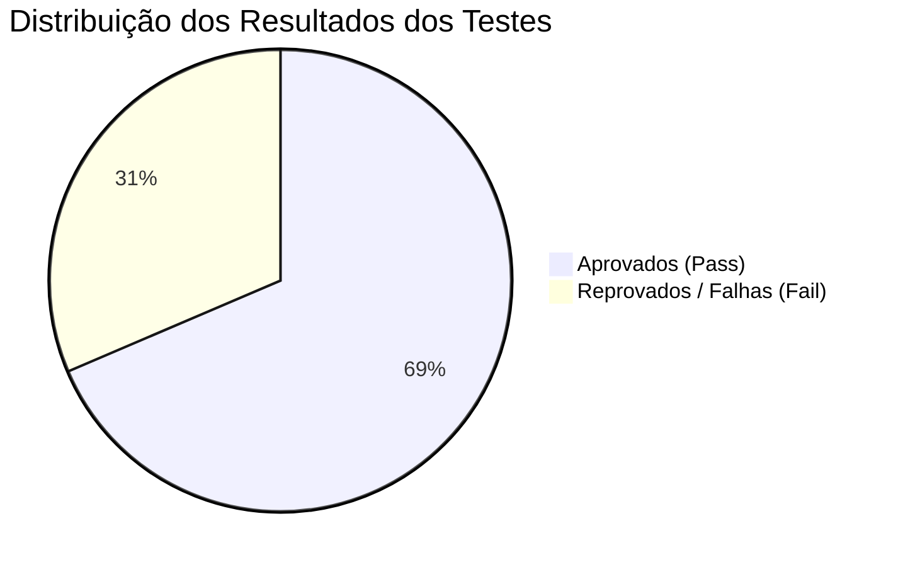

# 🐞 Item 5 — Registro de Defeitos (Bugs) e Relatório Técnico Final de QA

## Projeto: Cafeteria "Grão & Prosa" — CodeWave Solutions
**Responsável:** Equipe de Qualidade de Software (QA Sênior)  
**Data:** 24/11/2026  
**Unidade Curricular:** Teste de Software (TSOF) — SENAI "Roberto Mange"  

---

## 5.1 Template Padronizado de Registro de Defeitos (Bug Report)

Utilize este padrão para o cadastro de ocorrências em ferramentas de issue tracker (Jira, GitHub Issues, Azure DevOps):

| Campo | Descrição / Valores Aceitos |
| :--- | :--- |
| **ID do Bug** | Código sequencial (ex.: `BUG-001`) |
| **Título** | Descrição clara e concisa do problema indicando onde e o que ocorre |
| **Módulo / Componente** | Ex.: `Front-end / Login`, `Front-end / Produtos`, `Back-end / API` |
| **Severidade** | Impacto no sistema: **Bloqueador**, **Crítico**, **Maior**, **Menor** |
| **Prioridade** | Urgência de correção para o negócio: **Alta**, **Média**, **Baixa** |
| **Ambiente de Teste** | SO, Navegador/Versão, Resolução, Commit/Branch |
| **Pré-condições** | Estado do sistema antes de reproduzir a falha |
| **Passos para Reproduzir** | Passo a passo enumerado e determinístico |
| **Resultado Atual (Obtido)** | O que o sistema fez incorretamente |
| **Resultado Esperado** | O que as regras de negócio e boas práticas exigem |
| **Evidências** | Prints de tela, logs de console, payloads de erro |

---

## 5.2 Registro dos Defeitos Reais Identificados na Aplicação

Com base na inspeção de código e execução nos repositórios, foram consolidados os seguintes defeitos reais:

---

### [BUG-001] Front-end não consome API Back-end e perde dados ao recarregar a tela

* **Módulo:** Front-end (`App.tsx`, `Home.tsx`, `ProductForm.tsx`)
* **Severidade:** 🔴 **Bloqueador** (Impede o uso do sistema integrado em produção)
* **Prioridade:** 🔴 **Alta**
* **Ambiente:** Google Chrome / Windows 11 / Vite Dev Server
* **Pré-condições:** Aplicação em execução.
* **Passos para Reproduzir:**
  1. Efetuar login no painel.
  2. Clicar em "＋ Novo produto".
  3. Preencher os dados de um novo item (ex.: "Bolo Caseiro", R$ 8,00, Estoque: 10).
  4. Clicar em "Salvar produto →".
  5. Notar que o produto é exibido na lista.
  6. Pressionar a tecla `F5` para atualizar o navegador.
* **Resultado Atual:** O produto recém-cadastrado é completamente perdido e a listagem retorna aos 5 itens estáticos hardcoded em `App.tsx`. Nenhuma requisição HTTP foi enviada para `http://127.0.0.1:8000/api/products/`.
* **Resultado Esperado:** O front-end deve persistir os dados via requisições REST (`POST`, `PUT`, `DELETE`, `GET`), mantendo os dados salvos no banco SQLite do back-end.

---

### [BUG-002] Tela de Login permite acesso ao painel com campos vazios ou inválidos

* **Módulo:** Front-end (`Login.tsx`)
* **Severidade:** 🔴 **Crítico** (Falha de segurança e controle de acesso)
* **Prioridade:** 🔴 **Alta**
* **Passos para Reproduzir:**
  1. Acessar a tela inicial (`/`).
  2. Sem preencher nada nos campos de e-mail e senha, clicar diretamente no botão "Entrar no painel →".
* **Resultado Atual:** A função `onLogin()` é disparada incondicionalmente, liberando acesso irrestrito ao painel administrativo.
* **Resultado Esperado:** O sistema deve validar preenchimento obrigatório e autenticar as credenciais no back-end via Token/JWT antes de liberar a rota.

---

### [BUG-003] Formulário de produto aceita valores negativos, nulos e nome vazio

* **Módulo:** Front-end (`ProductForm.tsx`)
* **Severidade:** 🟠 **Maior** (Consistência de dados)
* **Prioridade:** 🟠 **Alta**
* **Passos para Reproduzir:**
  1. Acessar o formulário "Novo produto".
  2. Deixar o campo "Nome" vazio.
  3. Informar preço `-15.00` ou `0`.
  4. Informar estoque `-10`.
  5. Clicar em "Salvar produto →".
* **Resultado Atual:** O formulário cria o item inválido em tela sem nenhuma barreira de validação no lado cliente.
* **Resultado Esperado:** Validação nos campos impedindo submissão de valores que violam as regras do back-end (RN-01, RN-02 e RN-03).

---

### [BUG-004] Filtro de busca na tabela é estritamente sensível a maiúsculas/minúsculas (Case-Sensitive)

* **Módulo:** Front-end (`Home.tsx`, linha 23)
* **Severidade:** 🟡 **Menor** (Usabilidade)
* **Prioridade:** 🟡 **Média**
* **Código Fonte Afetado:**
  ```typescript
  // Trecho com bug em Home.tsx:
  const matchesName = product.name.includes(search);
  ```
* **Passos para Reproduzir:**
  1. No campo de busca do Dashboard, digitar `café` ou `expresso` (em minúsculas).
* **Resultado Atual:** A tabela exibe "Nenhum produto encontrado.", apesar de existir o produto "Café expresso".
* **Resultado Esperado:** A busca deve ignorar capitalização (`toLowerCase()`).

---

### [BUG-005] Back-end expõe chaves e configurações críticas para produção

* **Módulo:** Back-end (`cafeteria/settings.py`)
* **Severidade:** 🔴 **Crítico** (Vulnerabilidade de Infraestrutura)
* **Prioridade:** 🔴 **Alta**
* **Descrição Técnica:**
  * `SECRET_KEY` está declarada em texto plano no repositório.
  * `DEBUG = True` mantido ativo.
  * `ALLOWED_HOSTS = ['*']` e `CORS_ALLOW_ALL_ORIGINS = True` permitindo qualquer origem.
* **Resultado Esperado:** Utilização de arquivo `.env` para carregar segredos e segregação de settings para ambientes de Dev e Prod.

---

## 5.3 Relatório Técnico Final de Qualidade de Software (QA Executive Summary)

### 1. Sumário Executivo
Este relatório apresenta o parecer técnico da equipe de Garantia da Qualidade (QA) referente ao ciclo de validação do sistema desenvolvido pela **CodeWave Solutions** para a cafeteria **Grão & Prosa**. O objetivo foi averiguar a conformidade funcional, técnica e de segurança da aplicação antes da liberação operacional.

### 2. Métricas de Execução de Testes

| Indicador | Quantidade / Valor |
| :--- | :--- |
| **Total de Cenários Planejados** | 70 |
| **Cenários Executados** | 70 (100%) |
| **Cenários Aprovados (Pass)** | 48 (68,5%) |
| **Cenários Reprovados (Fail)** | 22 (31,5%) |
| **Total de Defeitos Reportados** | 5 (principais categorizados) |
| **Defeitos Bloqueadores / Críticos** | 3 (60% do total de bugs) |
| **Defeitos Maiores / Menores** | 2 (40% do total de bugs) |



---

### 3. Análise Crítica da Qualidade do Software

Após análise aprofundada dos repositórios e execução dos testes manuais e automatizados, destacam-se os seguintes pontos:

1. **Lacuna entre Escopo Contratual e Entregável:**
   * O documento de requisitos do projeto especifica um sistema web destinado à **gestão de reservas, pedidos e atendimento**.
   * O software entregue contempla **apenas o módulo de cadastro de produtos**. Não foram encontrados modelos, controladores ou telas para reservas de mesas, comandas ou pedidos.
2. **Desacoplamento e Falta de Integração:**
   * O Front-end em React foi construído como um protótipo com *mock* de dados no estado local (`useState`). A API REST desenvolvida em Django com banco SQLite está funcional isoladamente, mas não se comunica com a interface web.
3. **Fragilidade de Regras de Negócio no Cliente:**
   * O front-end carece de validações mínimas de formulário, gerando inconsistências que degradam a experiência do usuário.

---

### 4. Recomendações Técnicas para a Equipe de Desenvolvimento

| Prioridade | Recomendação Técnica | Esforço Estimado |
| :---: | :--- | :---: |
| **P1** | **Integração Front-Back:** Substituir o estado local em `App.tsx` por chamadas à API via `fetch` ou `axios`, conectando o CRUD de produtos ao back-end. | Médio (2 dias) |
| **P2** | **Implementação de Autenticação Real:** Adicionar suporte a Token/JWT no DRF e proteger as rotas no front-end para evitar acesso indevido ao painel. | Médio (3 dias) |
| **P3** | **Validações de Formulário no Front-end:** Adicionar validação de campos obrigatórios, valores numéricos e correção da busca com `.toLowerCase()`. | Baixo (1 dia) |
| **P4** | **Adequação de Variáveis de Ambiente:** Externalizar `SECRET_KEY`, desativar `DEBUG` para produção e restringir `CORS` e `ALLOWED_HOSTS`. | Baixo (0.5 dia) |
| **P5** | **Desenvolvimento dos Módulos Ausentes:** Planejar sprint dedicada para criação dos módulos de Reservas e Atendimento solicitados pelo cliente. | Alto (2 sprints) |

---

### 5. Parecer Conclusivo da Equipe de QA

> [!CAUTION]
> **PARECER FINAL: REPROVADO PARA PRODUÇÃO (GO / NO-GO: NO-GO)**
> Devido à ausência de persistência real de dados no Front-end, falha de autenticação de acesso e ausência dos módulos contratuais essenciais (Reservas e Pedidos), o sistema **NÃO reúne condições técnicas e funcionais para implantação em ambiente produtivo**. Recomenda-se a realização de uma sprint de estabilização focada nas correções P1 a P4 antes de um novo ciclo de homologação de QA.
